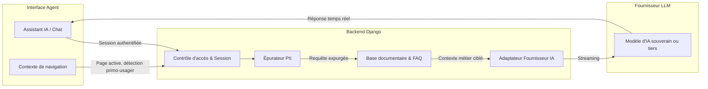

# Assistant IA (Chatbot) : Fonctionnement & Sécurité

L'Assistant IA accompagne les agents de collectivités et les gestionnaires territoriaux dans la qualification des dépôts sauvages, le respect des étapes de procédure administrative et la génération des actes juridiques.

Ce document présente l'architecture globale, le flux de traitement et les garanties de sécurité et de confidentialité appliquées à l'assistant.

---

## 1. Vue d'ensemble du fonctionnement

L'assistant fonctionne sous la forme d'un volet latéral interactif dans l'interface web, relié à un endpoint d'assistance en streaming côté serveur :

### Le cycle d'un échange
1. **Initialisation & détection du contexte** : L'assistant adapte ses suggestions d'accueil selon le profil de l'agent (primo-utilisateur sans dossier vs gestionnaire ayant des procédures en cours) et la page consultée.
2. **Recherche documentaire ciblée (RAG)** : Pour chaque question, le moteur interroge la base de connaissances métier (guides de procédure contradictoire, modèles types, FAQ administrative) pour fournir des règles juridiques à jour.
3. **Génération sécurisée en continu** : Le contexte enrichi est transmis au modèle d'IA sélectionné, qui diffuse sa réponse en direct à l'utilisateur.

---

## 2. Principes d'architecture & Sécurité

Conformément à la politique de sécurité globale de la plateforme, l'assistant repose sur une approche de **sécurité par défaut** :

### A. Accès strictement authentifié
- L'assistant est réservé aux agents publics connectés à l'application. Les visiteurs anonymes sont invités à se connecter via le fournisseur d'identité sécurisé (ProConnect) avant de pouvoir échanger.
- Toutes les requêtes vers l'API d'assistance requièrent une session valide avec jeton CSRF (`SessionAuthentication`).

### B. Confidentialité stricte & Protection des Données Personnelles (Zero-PII)
Pour préserver le secret professionnel et le RGPD lors des échanges avec des modèles de langage externes :
- **Anonymisation du contexte métier** : Les dossiers ne sont référencés que par des identifiants techniques opaques. Les données personnelles d'auteurs présumés, d'agents, adresses postales précises ou plaques d'immatriculation ne sont jamais injectées dans le prompt système.
- **Filtrage automatique à la volée** : Les messages saisis par l'utilisateur traversent un épurateur qui masque automatiquement les motifs sensibles identifiables (e-mails, numéros de téléphone, plaques, identifiants d'entreprises) avant tout appel au modèle d'IA.
- **Stockage expurgé et droit d'accès** : Les conversations enregistrées en base (`ChatbotConversation`) pour le suivi back-office font l'objet du même filtrage préventif (`scrub_pii`). Les données brutes identifiantes ne sont jamais persistées. L'accès à ces journaux est restreint aux membres habilités de l'équipe (`IsAdminUser`), avec une purge automatique des échanges après 180 jours (6 mois).

### C. Limitation de débit (Anti-DoS & Maîtrise des coûts)
- L'endpoint de streaming est protégé par un limiteur de débit applicatif dédié (`ChatbotRateThrottle`).
- Ce mécanisme prévient les attaques par saturation, les boucles de requêtes intempestives et protège l'infrastructure contre les surconsommations d'API (_Denial of Wallet_).

### D. Isolation des flux externes (Anti-SSRF)
- Les vérifications de disponibilité ou d'adresses réseau de serveurs d'inférence s'effectuent via des filtres stricts interdisant tout appel vers des adresses IP locales, privées ou de métadonnées d'infrastructure cloud.

---

## 3. Documents associés

- [Architecture globale de sécurité](./architecture-securite.md)
- [Politique de sécurité du projet](../SECURITY.md)
