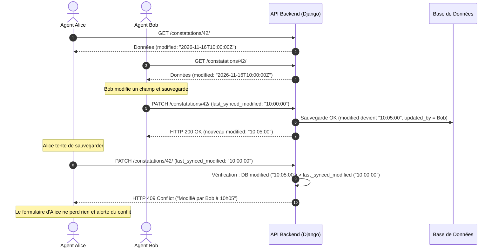

# Spécification Technique & Fonctionnelle : Organisation (Team) & Partage des Procédures

**Date de rédaction :** 16 novembre 2026  
**Statut :** Validé pour implémentation  
**Périmètre :** Backend Django, Authentification ProConnect, Modèles `Constatation` & `SuiviProcedure`, Permissions & API DRF, Backoffice

---

## 1. Contexte & Objectifs

Historiquement, les procédures (`Constatation` et son `SuiviProcedure`) étaient rattachées de manière exclusive à un utilisateur individuel (`user_id`). Deux agents d'une même commune ou brigade ne pouvaient ni visualiser, ni co-rédiger leurs dossiers.

**Objectifs de la fonctionnalité :**
1. **Passer d'une détention individuelle à une détention organisationnelle :** Les procédures appartiennent désormais à une organisation (`Team`).
2. **Partage complet au sein de l'organisation :** Tous les membres d'une même `Team` disposent des droits de lecture, d'édition, de complétion du formulaire (brouillon / finalisé), de génération des documents et de suivi.
3. **Auto-rattachement ProConnect intelligent :** L'agent rejoint automatiquement l'organisation correspondant au SIRET transmis par ProConnect (avec création automatique si première connexion).
4. **Protection stricte des corps nationaux (Option B validée) :** Exclusion des SIREN/SIRET nationaux (DGGN, MTE, DINUM, etc.) de l'auto-création et du regroupement automatique afin d'éviter qu'une multitude d'agents non colocalisés (ex. 35 gendarmes) partagent le même espace. Pour ces utilisateurs, `user.team` reste `None`, conservant un fonctionnement individuel étanche par défaut.
5. **Traçabilité détaillée :** Mémorisation explicite de `created_by` (créateur initial) et `updated_by` (dernier modificateur) sur `Constatation` et `SuiviProcedure`, en plus des timestamps automatiques (`created`, `modified`).

---

## 2. Modèle de Données

### 2.1. Modèle `Team` (dans `backend/accounts` ou `backend/teams`)

```python
from django.db import models
from model_utils.models import TimeStampedModel

class Team(TimeStampedModel):
    name = models.CharField("Nom de l'organisation", max_length=255)
    siret = models.CharField("SIRET", max_length=14, unique=True, db_index=True)
    siren = models.CharField("SIREN", max_length=9, blank=True, db_index=True)
    logo = models.ImageField("Logo", upload_to="team_logos/", blank=True, null=True)

    class Meta:
        verbose_name = "organisation"
        verbose_name_plural = "organisations"

    def __str__(self):
        return f"{self.name} ({self.siret})"
```

> **Note d'évolution :** Les rôles d'équipe (responsable d'équipe, gestionnaire d'équipe, délégation d'invitation) et configurations avancées (adresses email de notification d'équipe, fuseau horaire) sont **exclus de la v1** et pourront être ajoutés ultérieurement sans rupture.

### 2.2. Rattachement Utilisateur (`User.team`)

Ajout d'une clé étrangère sur l'`User` (ou profil équivalent) :
```python
team = models.ForeignKey(
    "teams.Team",
    on_delete=models.SET_NULL,
    null=True,
    blank=True,
    related_name="members",
    verbose_name="Organisation / Équipe",
)
```

### 2.3. Évolution des modèles `Constatation` et `SuiviProcedure`

#### A. `Constatation`
Remplacement sémantique du champ propriétaire `user` par le triptyque Propriété + Traçabilité :
* **`team`** (`ForeignKey(Team, on_delete=models.CASCADE, null=True, blank=True, related_name="constatations")`) : Organisation propriétaire du dossier.
* **`created_by`** (`ForeignKey(User, on_delete=models.SET_NULL, null=True, related_name="constatations_creees")`) : Auteur ayant initié la constatation.
* **`updated_by`** (`ForeignKey(User, on_delete=models.SET_NULL, null=True, blank=True, related_name="constatations_modifiees")`) : Dernier utilisateur ayant édité la constatation.
* *(Note : `constatant_nom`, `constatant_prenom`, `constatant_role` restent dédiés à l'identité légale de l'agent verbalisateur figurant sur le PV).*

#### B. `SuiviProcedure`
* Est lié à `Constatation` par `OneToOneField(Constatation, ...)` $\to$ l'organisation propriétaire est `constatation.team`.
* Ajout des champs de traçabilité directe :
  * **`created_by`** (`ForeignKey(User, on_delete=models.SET_NULL, null=True, related_name="suivis_crees")`)
  * **`updated_by`** (`ForeignKey(User, on_delete=models.SET_NULL, null=True, blank=True, related_name="suivis_modifies")`)
* *(Note : `personne_assignee` reste réservé aux membres de l'équipe backoffice/staff Dépôts Sauvages).*

---

## 3. Logique d'Auto-Rattachement ProConnect

Lors du callback OIDC / connexion ProConnect (`sync_proconnect_profile` ou `get_or_create_user` dans `backend/proconnect/auth.py`) :

### Règle d'éligibilité à l'auto-rattachement :
1. **L'utilisateur n'a pas déjà d'équipe :** `user.team is None`.
2. **Le SIRET est présent et valide :** `bool(siret) and len(siret) == 14`.
3. **Le SIRET / SIREN n'est pas exclu :** 
   * Ne figure pas dans la table de configuration des exclusions (gérée en base de données et administrable via le backoffice).
   * Une fixture initiale contiendra les exclusions connues au démarrage (DGGN, MTE, DINUM, etc.).

### Comportement selon le statut :
* **Cas éligible (Mairie, EPCI, Police Municipale) :**
  * Recherche d'une `Team` existante par `siret`.
  * Si inexistante : création avec `name = claims.get("organization_label") or f"Organisation {siret}"`, `siret=siret`, `siren=siret[:9]`.
  * Affectation : `user.team = team; user.save(update_fields=["team"])`.
* **Cas exclu ou sans SIRET (Option B validée) :**
  * `user.team` reste `None`.
  * L'utilisateur reste en mode individuel strict.
  * Si ultérieurement l'agent change d'organisme via ProConnect vers un SIRET éligible (commune), il rejoindra automatiquement sa nouvelle équipe sans conflit.

---

## 4. Configuration des Exclusions d'Auto-Création d'Équipe (Backoffice & Fixtures)

Afin d'éviter d'écrire en dur des SIREN/SIRET dans le code ou des variables d'environnement, une table de configuration dédiée est créée dans l'application `backend/teams`. Elle permet aux administrateurs de piloter les exclusions directement depuis le backoffice.

### 4.1. Modèle de Configuration : `TeamAutoCreationExclusion`

```python
class TeamAutoCreationExclusion(TimeStampedModel):
    """
    SIREN or SIRET numbers excluded from automatic Team creation and pooling
    during ProConnect authentication (e.g. national police, ministries, headquarters).
    Users with these identifiers remain in individual mode (user.team is None).
    """
    siren = models.CharField("SIREN", max_length=9, blank=True, db_index=True)
    siret = models.CharField("SIRET", max_length=14, blank=True, db_index=True)
    label = models.CharField("Nom de l'organisme / Direction", max_length=255)
    reason = models.TextField("Motif de l'exclusion", blank=True)

    class Meta:
        verbose_name = "exclusion d'auto-création d'équipe"
        verbose_name_plural = "exclusions d'auto-création d'équipe"

    def __str__(self):
        return f"{self.label} ({self.siret or self.siren})"
```

### 4.2. Fixture initiale
Une fixture initiale (`fixtures/initial_team_autocreation_exclusions.json`) est chargée lors du déploiement avec les identifiants déjà identifiés :
* **DGGN (Direction Générale de la Gendarmerie Nationale)**
* **MTE (Ministère de la Transition Écologique)**
* **DINUM (Direction Interministérielle du Numérique)**
* Tout autre organisme national identifié dans la base existante.

### 4.3. Gestion dans le Backoffice
* Un onglet / panneau d'administration dans le backoffice permet de lister, ajouter et supprimer des exclusions facilement sans redémarrage serveur.

---

## 5. Matrice des Droits et Permissions

Le système de permissions repose sur le principe de **partage intégral au sein de l'organisation** tout en préservant l'accès d'un agent sans équipe à ses propres dossiers.

### 5.1. Règle d'accès et filtrage (`get_queryset`)

Pour tout utilisateur authentifié non-staff :
```python
def get_user_constatations_queryset(user):
    if user.team_id:
        # User belongs to an organization: access to all procedures of the team
        return Constatation.objects.filter(team_id=user.team_id)
    else:
        # User has no team: access strictly to their own creations
        return Constatation.objects.filter(team__isnull=True, created_by=user)
```

Pour les membres du personnel (`user.is_staff = True`) :
* Accès universel en lecture/écriture à l'ensemble des procédures (inchangé).

### 5.2. Matrice d'actions détaillées

| Ressource / Action | Membre de l'équipe (`user.team == procedure.team`) | Agent sans équipe (`team is None` & `created_by == user`) | Autre agent externe | Staff / Back-office |
| :--- | :---: | :---: | :---: | :---: |
| **Lister les procédures** | Oui (toutes celles de l'équipe) | Oui (uniquement les siennes) | Non (filtrées) | Oui (toutes) |
| **Créer un constat** | Oui (`team=user.team`, `created_by=user`) | Oui (`team=None`, `created_by=user`) | - | Oui |
| **Voir le détail d'un constat** | Autorisé | Autorisé | 404 / 403 | Autorisé |
| **Modifier le constat / brouillon** | Autorisé (`updated_by=user`) | Autorisé (`updated_by=user`) | 404 / 403 | Autorisé |
| **Générer / Télécharger les docs** | Autorisé | Autorisé | 404 / 403 | Autorisé |
| **Consulter le Suivi de procédure** | Autorisé | Autorisé | 404 / 403 | Autorisé |
| **Modifier le Suivi de procédure** | Autorisé (`updated_by=user`) | Autorisé (`updated_by=user`) | 404 / 403 | Autorisé |

### 5.3. Traçabilité des écritures
* **À la création d'un constat (`perform_create`) :**
  * `team = request.user.team`
  * `created_by = request.user`
  * `updated_by = request.user`
* **À la modification d'un constat (`perform_update`) :**
  * `updated_by = request.user`
* **Sur le suivi de procédure (`SuiviProcedureViewSet`) :**
  * À la première initialisation : `created_by = request.user`
  * À chaque mise à jour : `updated_by = request.user`

### 5.4. Évolution des Logs d'Activité (`activity_logs`)
Une tâche d'évaluation est prévue pour enrichir le suivi d'activité :
* Ajout du `team_id` dans les métadonnées de log (`TrackActivityMixin`).
* Distinction dans les logs entre action personnelle et action au sein d'une équipe.
* Vérification de l'impact sur la table `stats_activity_log` et l'anonymisation des données.

---

## 6. Gestion des Conflits et de la Co-édition (Verrouillage Optimiste)

Avec l'ouverture du dossier à tous les membres de l'organisation, le risque principal est le **conflit d'écriture silencieux** (*Lost Update*, ex: l'agent A et l'agent B éditent le même constat en même temps et l'un écrase les modifications de l'autre).

Pour garantir une solution simple, sans infrastructure lourde (ni Redis, ni WebSockets), nous implémentons un **Verrouillage Optimiste** (*Optimistic Concurrency Control*) basé sur le champ `modified` présent nativement grâce à `TimeStampedModel`.

### 5.1. Principe de Fonctionnement



### 5.2. Spécification Backend

Dans `ConstatationViewSet` (et similairement sur `SuiviProcedureViewSet`) :
1. Le client envoie lors de ses requêtes `PUT`/`PATCH` le champ `last_synced_modified` (timestamp ISO de la version qu'il détenait).
2. Si `last_synced_modified` est fourni et que la date `instance.modified` en base est strictement plus récente (avec une tolérance de 1 seconde pour l'autosave), le serveur rejette la requête avec un code **`HTTP 409 Conflict`** :
   ```json
   {
     "error": "CONCURRENT_MODIFICATION",
     "message": "Ce dossier a été modifié par Marc DUPONT entre-temps.",
     "updated_by": "Marc DUPONT",
     "server_modified": "2026-11-16T10:05:00.123456Z"
   }
   ```
3. Si le client envoie un flag optionnel `force=True`, la modification est appliquée en écrasement volontaire (dernier recours).

### 5.3. Spécification Frontend (`frontend/stores/constatation.ts` & `suivi-procedure.ts`)

1. **Conservation de l'empreinte temporelle :**
   * Au chargement (`loadConstatation`), le store conserve `lastSyncedModified = data.modified`.
   * Chaque appel à `performSave` inclut `last_synced_modified: this.lastSyncedModified`.
   * En cas de succès `200` : `this.lastSyncedModified = res.modified`.
2. **Traitement de l'erreur 409 Conflict :**
   * L'autosave est immédiatement suspendu pour ne pas boucler.
   * Les données saisies localement par l'agent sont **intégralement préservées** dans son navigateur.
   * Une modale ou bannière d'arbitrage est affichée :
     > **Attention : Conflit d'édition détecté**  
     > *{updated_by} a modifié cette procédure récemment.*  
     > - **[Recharger la version serveur]** : pour adopter les modifications du collègue (avec avertissement sur la perte des saisies locales non sauvées).  
     > - **[Conserver et écraser]** : relance `performSave` avec `force=true` si l'agent sait que sa saisie prime.

---

## 7. Stratégie de Migration des Données Existantes

Pour passer de l'état actuel (`user_id` unique) à la nouvelle structure :

1. **Migration de schéma Django :**
   * Création de la table `teams_team`.
   * Création de la table `teams_teamautocreationexclusion`.
   * Ajout de `team_id` sur `User`.
   * Renommage / Ajout de `created_by_id`, `updated_by_id`, `team_id` sur `Constatation`.
   * Ajout de `created_by_id`, `updated_by_id` sur `SuiviProcedure`.
2. **Chargement des exclusions initiales :**
   * Chargement de la fixture `initial_team_autocreation_exclusions.json`.
3. **Data Migration :**
   * Pour chaque `Constatation` existante : `created_by_id = user_id`, `updated_by_id = user_id`.
   * Pour chaque utilisateur ayant un `ProConnectProfile` avec un SIRET valide non exclu :
     * Création de l'équipe `Team` associée si elle n'existe pas.
     * `user.team = team`.
     * Rapprochement des constatations historiques : `constatation.team = team`.
   * Pour les utilisateurs avec SIRET exclu (DGGN, MTE, etc.) : `user.team` reste `None`, `constatation.team` reste `None`.
4. **Mise à jour des API & métriques utilisateurs :**
   * Dans `current_user` : `procedures_count` reflète les procédures visibles de l'équipe (ou individuelles si sans équipe).
   * Ajout des infos d'organisation dans la payload `/api/current-user/` (`team_id`, `team_name`, `team_logo`).

---

## 8. Vérifications & Sécurité

* **Isolation étanche :** Les vues et téléchargements de documents (`ConstatationDocumentDownloadView`) vérifient systématiquement l'appartenance à `constatation.team` (ou `created_by` si `team is None`).
* **Intégrité en base :** Les clés `team` et `created_by` prévoient des politiques de suppression sûres (`SET_NULL` pour les utilisateurs afin de ne pas perdre de procédures lors du départ d'un agent).
* **Respect des règles projet :** Tout déploiement ou promotion reste manuel sous contrôle humain strict (pas de push auto vers prod).
