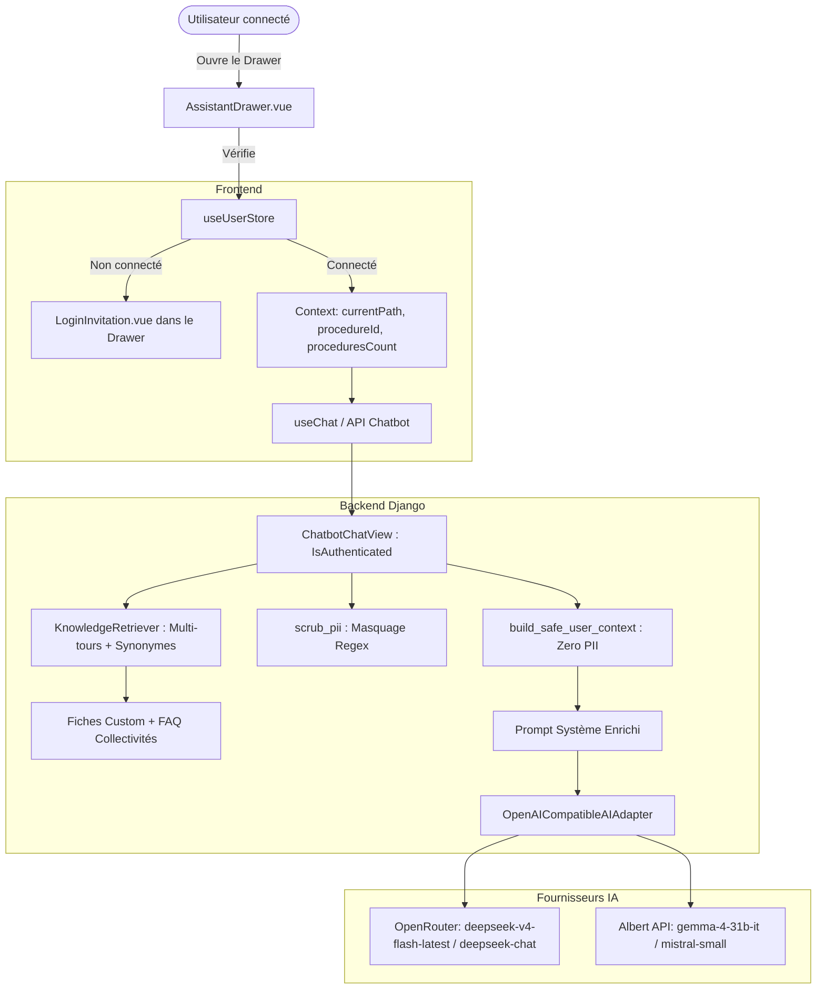

# Spec Technique : Pertinence Globale & Sécurisation de l'Assistant IA (Stop Dépôt Sauvage)

Date : 2026-11-05
Statut : Validé

---

## 1. Objectifs & Exigences Fondamentales

1. **Accès réservé aux utilisateurs connectés** :
   - L'Assistant IA ne doit être accessible qu'aux comptes authentifiés.
   - Les utilisateurs anonymes doivent voir un état d'invitation à la connexion avec le composant `LoginInvitation` (ProConnect / Login Démo), comme sur `/mes-procedures`.
   - L'API Django `/api/chatbot/chat/` doit exiger `IsAuthenticated` (HTTP 401/403 si non connecté).

2. **Confidentialité stricte & Zero-PII (Données Personnelles & Sensibles)** :
   - Aucune PII (Nom, prénom, email, téléphone, adresse postale, SIRET, plaque d'immatriculation, observations internes) ne doit être transmise aux LLMs (OpenRouter, Albert API).
   - Les contextes injectés contiennent uniquement des identifiants techniques anonymisés (`#14`), des volumes/types de déchets, des délais et des statuts d'étapes.
   - Un épurateur Regex (`scrub_pii`) assainit à la volée les messages utilisateur avant transmission au modèle d'IA.

3. **Activation proactive des Primo-utilisateurs vs Accompagnement des Utilisateurs avec Procédures** :
   - Si `procedures_count == 0` : l'assistant détecte le profil débutant, adapte ses questions d'accueil vers la qualification du dépôt et l'incitation à créer un premier brouillon en levant les faux freins juridiques (pas d'assermentation requise, etc.).
   - Si `procedures_count > 0` : l'assistant propose des suggestions de suivi contextuelles liées à ses dossiers actifs ou au dossier actuellement ouvert (`/suivi-procedure/:id`).

4. **Pertinence Métier & RAG Multi-tours Rapproché** :
   - Intégration d'une fiche métier `guide_suivi_procedure_et_modeles.md` détaillant les règles précises du contradictoire (10 jours, Pli non réclamé vs NPAI, calcul du préjudice, 7 modèles de documents).
   - Exclusion de la FAQ citoyen `vous_n_êtes_pas_une_collectivité.md` pour les agents de collectivités.
   - Moteur de recherche RAG hybride prenant en compte l'historique multi-tours et une table de synonymes métier.

5. **Modèles LLM supportés** :
   - Support d'OpenRouter avec `deepseek/deepseek-chat` et `deepseek/deepseek-v4-flash-latest`.
   - Support d'Albert API avec `mistral-small-3-2-24b-instruct-2506` et `gemma-4-31b-it`.

---

## 2. Architecture & Composants

---

## 3. Plan d'Implémentation Détaillé

### Tâche 1 : Backend - Sécurisation API, Zero-PII & Contexte Anonymisé
- Fichiers créés : `backend/chatbot/context.py`
- Fichiers modifiés : `backend/chatbot/views.py`, `backend/chatbot/adapters.py`
- Tests : `backend/chatbot/tests.py`

### Tâche 2 : Base de Connaissance Métier & Moteur RAG Multi-tours
- Fichiers créés : `backend/chatbot/knowledge/custom/guide_suivi_procedure_et_modeles.md`
- Fichiers modifiés : `backend/chatbot/retriever.py`
- Tests : `backend/chatbot/tests.py`

### Tâche 3 : Support Modèles OpenRouter (deepseek-v4-flash-latest) & Albert
- Fichiers modifiés : `backend/chatbot/adapters.py`
- Tests : `backend/chatbot/tests.py`

### Tâche 4 : Frontend - Splash ProConnect, Contexte de Navigation & Prompts Adaptatifs
- Fichiers modifiés : `frontend/components/AssistantDrawer.vue`
